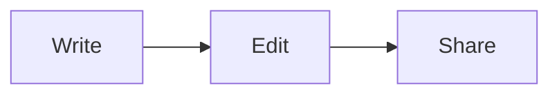

# Welcome to Downpad 👋

**Downpad** is a lightweight, pure-WYSIWYG markdown editor. You're looking at the
welcome document — edit it, discard it, or **Save As** to keep it. It won't appear
again.

## The basics

Type normally and formatting just works. Try **bold**, *italic*, ~~strikethrough~~,
and `inline code`. Press **Ctrl+B** / **Ctrl+I** on a selection, or use the
floating toolbar that appears when you select text. Type `/` on a new line to open
the **slash menu** for blocks.

## Lists and tasks

- A bullet list
- Nested ideas with **Tab**
  - Like this

1. Ordered too
2. Just start a line with `1.`

- [ ] An interactive task
- [x] Tick it in WYSIWYG view

## Tables

| Feature        | Shortcut         |
| -------------- | ---------------- |
| Find           | Ctrl+F           |
| Replace        | Ctrl+H           |
| Toggle raw view | toolbar button  |

## Code, math, and diagrams

```ts
function greet(name: string) {
  return `Hello, ${name}!`;
}
```

Inline math like $E = mc^2$ and block math render with KaTeX:

$$
\int_0^1 x^2 \, dx = \frac{1}{3}
$$

A Mermaid diagram renders below its source:



## Links and images

Links show their destination: [Anthropic](https://anthropic.com). Ctrl+click to
open in your browser.

Paste a screenshot and it embeds instantly. Images linked from disk show inline:


## Make it yours

Open **Settings** (⚙) to change the theme, body font, editor width, link display,
and how markdown is written back. Everything lives in a human-editable
`settings.toml` you can also edit by hand.

> Single source of truth: the markdown string is canonical, so switching between
> WYSIWYG and raw views never loses content.

Happy writing!
